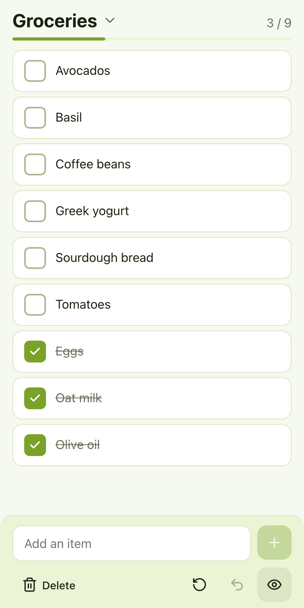
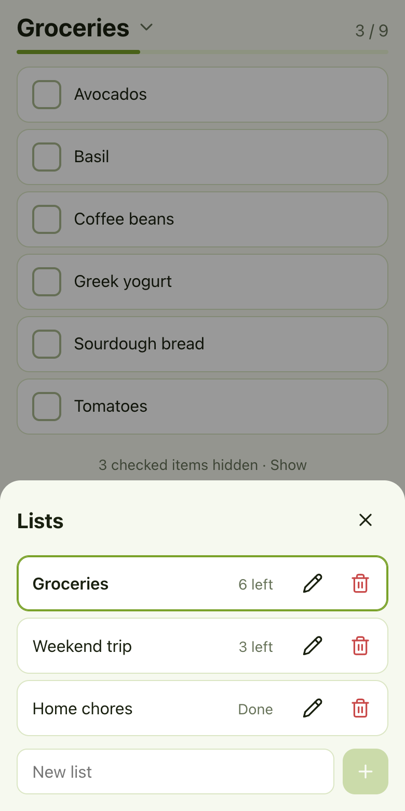
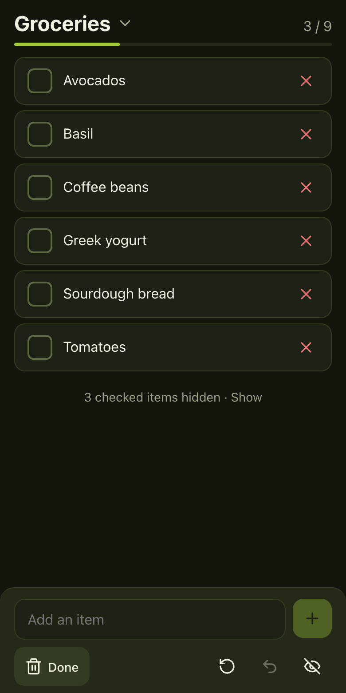

<div align="center">


# Checklist

**The checklist app that respects your privacy.**
Built from the ground up so that your lists stay yours: no account, no cloud, no tracking.

🔒 **Private by design · 📴 Works offline · 🚫 No account**

[**Open the app →**](https://janissedev.github.io/checklist-vuejs/)

<br>


&nbsp;

&nbsp;


</div>

## Why this app?

Checklist was created with one goal: **protecting your privacy**.

A shopping list, a packing list or a to-do list says a lot about you: what you eat, where you travel, your health, your plans. Most list apps ask you to create an account and store all of this on their servers, where it can be analyzed, shared or exposed in a data breach.

Checklist takes the opposite approach. Your lists **never leave your device**, because the app has nowhere to send them.

## Privacy by design

Privacy isn't a setting here, it's how the app is built:

| | |
|---|---|
| 🚫 **No account** | Nothing to sign up for. No email, no password, no phone number. |
| ☁️ **No online storage** | No backend, no database. Your lists live only in your browser's local storage, on your device. |
| 👁️ **No tracking** | No analytics, no cookies, no ads, no third-party scripts or fonts. |
| 📴 **No network needed** | Once loaded, the app works fully offline, even in airplane mode. |
| 🔍 **Verifiable** | The source code is public: you can check every claim above yourself. |

**Good to know:** GitHub Pages, which hosts the app, only serves its static files. Like any web host, it may log standard request data (such as your IP address) when the app is downloaded, but it never receives your lists. Since nothing is synced, each device keeps its own lists, and clearing your browser's site data for the app erases them.

## Features

- **Multiple lists:** tap the title to switch, create, rename or delete lists.
- **Quick adding:** type and press Enter. Adding an item that already exists brings it back instead of duplicating it.
- **Progress at a glance:** a counter and progress bar for the current list.
- **Hide checked items** to focus on what's left, or show them crossed out at the bottom.
- **Undo** any change: checking, adding, deleting, unchecking everything.
- **Uncheck all** in one tap to reuse a list (perfect for weekly groceries).
- **Works fully offline** and installs on your home screen as a PWA.
- **Light and dark themes** that follow your system setting.

## Install on your phone

Open the [app](https://janissedev.github.io/checklist-vuejs/) and:

- **iOS (Safari):** Share → *Add to Home Screen*
- **Android (Chrome):** menu ⋮ → *Install app*

## Tech stack

- [Vue 3](https://vuejs.org/) with `<script setup>`
- [Pinia](https://pinia.vuejs.org/) for state, persisted to `localStorage` with [pinia-plugin-persistedstate](https://prazdevs.github.io/pinia-plugin-persistedstate/)
- [Vite](https://vite.dev/) and [vite-plugin-pwa](https://vite-pwa-org.netlify.app/) for the build and offline support

Undo keeps a short history per list of *what changed* (not copies of the whole list), so it stays light even with long lists.

## Development

```sh
npm install      # install dependencies
npm run dev      # start the dev server with hot reload
npm run build    # build for production into dist/
npm run preview  # serve the production build locally
```

## Deployment

The app is hosted on GitHub Pages from the `gh-pages` branch, which contains the contents of `dist/`:

```sh
npm run build
git add dist && git commit -m "Deploy"
git subtree push --prefix dist origin gh-pages
```

The Vite `base` is set to `/checklist-vuejs/` in [`vite.config.js`](vite.config.js) to match the GitHub Pages URL.

## Project structure

```
src/
├── components/
│   ├── AppIcon.vue        # inline SVG icons (follow the theme color)
│   └── ListPicker.vue     # bottom sheet to switch and manage lists
├── stores/
│   └── checklistStore.js  # lists, items, undo history, persistence
├── views/
│   └── HomeView.vue       # main screen
└── assets/main.css        # theme colors (light and dark) and shared styles
```
